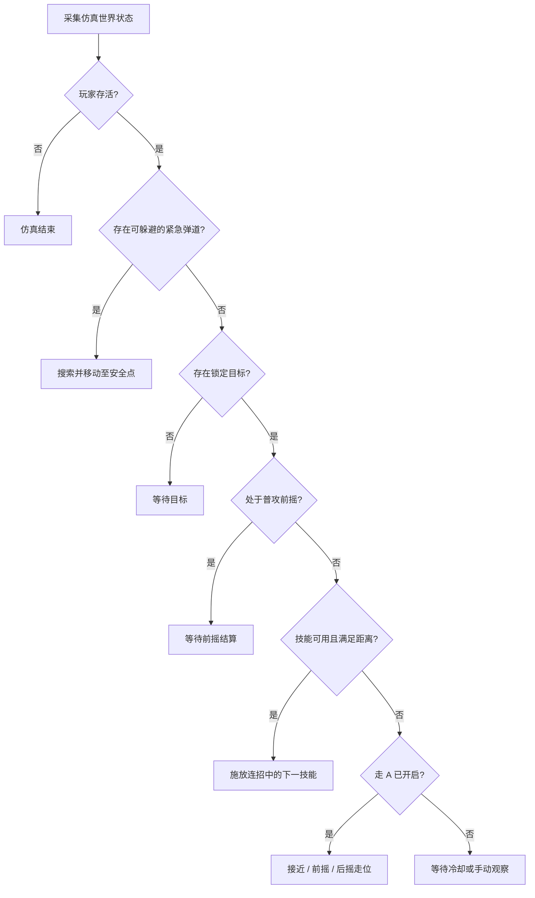

# 决策实验室 · LOL Decision Lab

一个完全离线运行的战术决策仿真器，用可视化的方式研究目标选择、匀速弹道预测、安全点搜索、连招状态机，以及不同攻速下的走 A 节奏。

> **自娱自乐，认真折腾。** 本项目不连接《英雄联盟》，不读取或修改任何游戏进程，不包含注入、内存读写、反作弊绕过、皮肤修改或真实对局自动控制功能。

## 项目定位

这不是游戏外挂，也不是某种注入器的“离线模式”。项目中的角色、敌人、技能、弹道、伤害和世界规则全部由程序生成，所有决策只作用于内置的二维仿真世界。

它适合用来：

- 学习状态机、几何预测和简单决策算法；
- 观察前摇、后摇、攻击间隔与移动之间的关系；
- 调整参数并直观看懂每一次决策的原因；
- 在非商用前提下继续二创，做成新的仿真、教学或算法实验项目。

## 下载 Windows 成品

前往 [v1.0.0 发布页](https://github.com/linssenstudio/lol-decision-lab/releases/tag/v1.0.0)：

| 文件 | 用途 | 大小 |
| --- | --- | ---: |
| `Decision-Lab-Setup-1.0.0-x64.exe` | Windows x64 安装版，可选择安装目录并创建快捷方式 | 约 115.6 MiB |
| `Decision-Lab-Portable-1.0.0-x64.zip` | Windows x64 免安装版，解压后运行 `决策实验室.exe` | 约 146.0 MiB |

两个包都包含完整运行环境，安装后不需要 Node.js，也不需要启动开发服务器。

**签名说明：** v1.0.0 没有商业代码签名证书，Windows 可能显示 SmartScreen 提示。发布页提供 SHA-256，可用于核对下载文件。当前构建产物已在 macOS 上完成格式、内容和 ZIP 完整性检查，但仍建议进行 Windows 10/11 x64 实机安装验证。

## 已实现功能

### 1. 流畅走 A

- 8 档攻速：`0.75 / 1.00 / 1.25 / 1.50 / 1.75 / 2.00 / 2.25 / 2.50` 次/秒；
- `idle → windup → recovery` 普攻状态机；
- 前摇期间禁止移动，不提前扣除目标生命；
- 前摇结束时才结算 34 点普攻伤害；
- 伤害结算后立即进入可移动的后摇阶段；
- 默认后撤，接近边界时自动尝试侧向走位；
- 可独立开启，也可在技能冷却期间填充普攻与走位；
- 面板实时显示攻击间隔、前摇、后摇，角色外圈显示攻击相位。

### 2. 弹道预测与自动躲避

- 将弹道建模为带预警延迟的匀速直线运动；
- 计算弹道与目标最近接近时间及距离；
- 只保留预测窗口内进入安全余量的威胁；
- 在角色周围 4 个半径、每个半径 24 个方向采样安全点；
- 综合碰撞风险和移动成本选择更优位置；
- 紧急躲避优先于连招和走 A。

### 3. 连招与目标选择

内置三套仅属于仿真世界的技能序列：

- 标准消耗：`Q → W → E`；
- 爆发终结：`W → Q → R`；
- 突进衔接：`E → Q → W`。

点击敌人可锁定目标。技能超范围时先接近，距离与冷却满足后才施法；切换目标或连招序列会重置连招位置。

### 4. 可观察的决策过程

- 当前状态、决策原因、锁定目标、下一技能、最近威胁和安全位置；
- 对象生命值、坐标与状态表；
- 动作输出日志，包括前摇、普攻、施法、移动、躲避和命中；
- 实时调整决策间隔、预测窗口、安全余量、仿真速度和敌方施法间隔。

## 核心原理

### 攻击节奏

设攻速为 `s` 次/秒：

```text
攻击间隔 interval = 1 / s
前摇 windup = clamp(0.18 / s, 0.055, 0.22)
后摇 recovery = interval - windup
```

各档位如下，表内数值四舍五入到毫秒：

| 攻速（次/秒） | 攻击间隔（秒） | 前摇（秒） | 后摇（秒） |
| ---: | ---: | ---: | ---: |
| 0.75 | 1.333 | 0.220 | 1.113 |
| 1.00 | 1.000 | 0.180 | 0.820 |
| 1.25 | 0.800 | 0.144 | 0.656 |
| 1.50 | 0.667 | 0.120 | 0.547 |
| 1.75 | 0.571 | 0.103 | 0.469 |
| 2.00 | 0.500 | 0.090 | 0.410 |
| 2.25 | 0.444 | 0.080 | 0.364 |
| 2.50 | 0.400 | 0.072 | 0.328 |

状态转换：

```text
待机 idle
  │ 目标在范围内且攻击冷却结束
  ▼
前摇 windup
  │ 禁止移动；倒计时结束才结算伤害
  ▼
后摇 recovery
  │ 可以移动；攻击冷却结束后回到待机
  ▼
待机 idle
```

实现上，`attackStart` 只启动前摇并设置攻击冷却，不直接扣血；`updateAttack(dt)` 在前摇计时结束时结算伤害。移动更新也会在前摇阶段暂停，避免决策切换意外取消本次普攻。

### 决策优先级



### 最近接近计算

`src/engine/math.js` 使用弹道位置、速度、剩余射程和预警延迟，求目标点到弹道运动射线的最近点。若最近距离小于“角色半径 + 弹道半径 + 安全余量”，且到达时间位于预测窗口内，该弹道会进入威胁列表。

安全点搜索不是读取游戏导航网格，而是在二维世界中直接采样。每个候选点都会重新计算风险，并加入少量移动成本，避免为了极小的安全收益进行无意义的大幅移动。

## 操作方式

- 点击空地：手动移动；
- 点击敌人：锁定目标；
- 空格：暂停或继续；
- `R`：重置世界；
- 参数面板：开关自动连招、自动躲避和走 A，调整攻速与预测参数；
- 底部检查器：切换决策轨迹、对象状态和动作输出。

手动移动会短暂保留控制权，但紧急躲避仍可打断。重置会恢复对象、弹道、冷却和日志，保留当前实时参数。

## 本地开发

建议使用当前 Node.js LTS。本项目已在 Node.js `24.22.1` 下完成验证。

```bash
git clone https://github.com/linssenstudio/lol-decision-lab.git
cd lol-decision-lab
npm install
npm run dev
```

打开终端显示的本地地址即可。常用命令：

```bash
# 运行全部单元测试
npm test

# 构建浏览器资源
npm run build

# 本地启动 Electron 桌面版
npm run desktop

# 首次构建安装包前，准备图标生成依赖
python -m pip install Pillow

# 构建 Windows x64 NSIS 安装程序
npm run dist:win

# 构建 Windows x64 免安装 ZIP
npm run dist:portable
```

`dist:win` 和 `dist:portable` 会先通过 `scripts/generate-icon.py` 生成 PNG 与 ICO 图标，因此图标生成需要 Python 和 Pillow；仅运行网页或桌面开发模式时不需要。

Windows 构建配置位于 `electron-builder.yml`。默认输出到 `release/`。在 Apple Silicon Mac 上构建时，配置使用 `nsis: 1.2.1` 工具链，避免旧版 Intel-only `makensis` 的架构问题。

仓库还包含 `.github/workflows/release.yml`：可手动运行 Windows 发布工作流，自动安装依赖、执行测试、构建两个成品、生成 `CHECKSUMS.txt` 并发布到 `v1.0.0` Release。

## 测试与验证

```bash
npm test
npm run build
node scripts/browser-check.mjs
```

当前共有 **21 项单元测试**，覆盖：

- 8 个攻速档位的前摇、后摇和连续攻击间隔；
- 前摇期间不提前伤害、不允许移动；
- 后撤位置的世界边界限制；
- 最近接近计算与威胁筛选；
- 安全点搜索、连招推进和范围判断；
- 伤害、冷却、日志、目标选择和重置行为。

`browser-check.mjs` 会临时启动本地服务和无头 Chrome，验证暂停/继续、参数切换、目标点击、手动移动、动作日志和页面溢出，并在结束后关闭服务与浏览器。

## 项目结构

```text
lol-decision-lab/
├── desktop/
│   └── main.cjs              # Electron 安全桌面壳
├── docs/
│   └── RELEASE_v1.0.0.md     # 版本发布说明
├── scripts/
│   ├── browser-check.mjs     # 真实浏览器交互回归检查
│   └── generate-icon.py      # 应用图标生成
├── src/
│   ├── engine/
│   │   ├── attack-move.js    # 攻速计算与走 A 决策
│   │   ├── data.js           # 世界、技能与默认参数
│   │   ├── decision.js       # 威胁分析与总决策状态机
│   │   ├── math.js           # 几何与最近接近计算
│   │   └── simulation.js     # 世界更新与动作结算
│   ├── ui/
│   │   └── renderer.js       # Canvas 2D 渲染
│   ├── main.js               # 界面绑定与状态展示
│   └── styles.css
├── tests/                    # Node.js 单元测试
├── build/                    # 安装包图标
├── electron-builder.yml      # Windows 安装包配置
├── vite.config.js
└── package.json
```

桌面版使用本地文件加载，启用上下文隔离与沙箱，禁用 Node 集成，并阻止窗口内的外部导航。

## 非商用与二创说明

本项目采用 **PolyForm Noncommercial License 1.0.0**。它不是 OSI 定义的开源许可证，而是一种“源码可见、仅限非商用”的许可证。

### 可以做

- 个人学习、研究、测试和离线娱乐；
- 修改代码、调整算法、重画界面；
- 在非商用前提下发布自己的修改版；
- 为非商业教育、研究和公共知识目的使用；
- 分享思路和问题，提交 Issue 或 Pull Request。

### 不可以做

- 出售源码、安装包或修改版；
- 通过付费下载、付费社群、捆绑销售等方式变现；
- 将本项目用于商业产品、商业服务或商业运营；
- 移除或替换许可证、版权和来源说明；
- 将本项目改造成真实游戏注入器、外挂或反作弊绕过工具。

二创发布时，请同时提供本许可证全文或许可证链接，并保留下面的来源声明：

```text
Required Notice: Copyright 2026 linssenstudio (https://github.com/linssenstudio/lol-decision-lab)
```

以上只是便于阅读的摘要，具体权利与义务以 [LICENSE](LICENSE) 全文为准。需要商业授权时，请先联系原作者并另行取得许可。

## 欢迎怎样的二创

- 新的仿真地图、敌方行为和压力测试场景；
- 更平滑的走 A 轨迹、不同角色模型和可配置攻击曲线；
- 更丰富的威胁预测、路径规划和决策可视化；
- 动作时间轴、攻速命中率统计、实验数据导出；
- 教学课程、算法文章或纯离线训练工具。

请保持项目的离线边界，不要提交面向真实游戏的注入、内存读写、自动控制或反作弊绕过功能。

## 参与贡献

1. Fork 仓库并创建功能分支；
2. 清楚描述修改目的、行为变化与验证方法；
3. 新增或更新对应测试；
4. 确保 `npm test` 和 `npm run build` 通过；
5. 提交 Pull Request，并确认改动符合非商用许可证。

## 免责声明

- 本项目与 Riot Games、腾讯及《英雄联盟》官方没有关联，也未获得其背书。
- 项目没有使用官方游戏素材、游戏数据、客户端接口或真实对局数据。
- 软件按“现状”提供，不保证适合任何特定用途；使用与修改风险由使用者自行承担。
- Electron、Chromium 和其他依赖仍遵循各自的第三方许可证。

## 当前版本

### v1.0.0

- 完整的离线战术仿真与决策检查器；
- 连招、弹道预测、自动躲避和目标选择；
- 8 档攻速的流畅走 A；
- Windows x64 安装版与免安装版；
- 21 项单元测试和浏览器交互检查。

本项目始于个人学习和自娱自乐。欢迎有更多想法的人，在非商用、保留来源和遵守边界的前提下继续二创。
